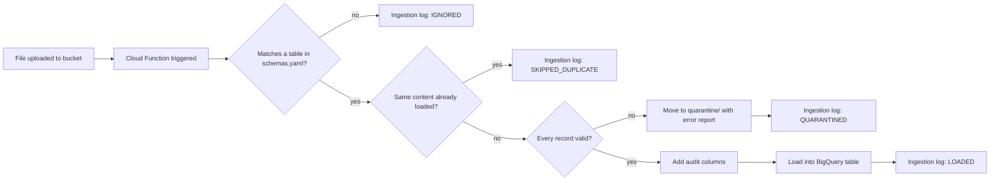

# GCP Lab: Cloud Storage to BigQuery ETL with Cloud Functions

Author: Tirth Borasaniya, IE-7374 MLOps

Based on `Labs/GCP_Labs/CloudFunction_Labs/Lab1-CloudFunction_Setup` from the IE-7374 MLOps course repository. The original lab builds a Cloud Function that runs when a file is uploaded to a Cloud Storage bucket and loads the file into BigQuery. This version keeps that purpose and pipeline, uses a different dataset, and adds validation, transformation, logging, and duplicate protection.

## How it works



## Summary of changes

| Area | Original lab | This repository |
| --- | --- | --- |
| Dataset | Generic people records (`table_1` to `table_6`) | E-commerce orders (JSON, nested line items) and customers (CSV) |
| File formats | Newline-delimited JSON only; five other configured formats ignored | JSON and CSV, both working |
| Validation | None; invalid files fail inside BigQuery or are silently skipped | Every record checked against the schema; bad files moved to a quarantine folder with an error report |
| Transformation | None (extract and load only) | Typed conversion of CSV values, plus `ingested_at` and `source_file` audit columns |
| Monitoring | Print statements only | `ingestion_log` table in BigQuery recording the outcome of every file |
| Duplicates | Re-uploading a file loads it again | Identical content is detected and skipped |
| Setup | Manual steps in the Cloud Console | `deploy.sh`, `run_demo.sh`, and `teardown.sh` scripts |
| Tests | None | 90 unit and pipeline tests that run without GCP, plus a GitHub Actions workflow |
| Permissions | BigQuery Admin | Least-privilege roles (BigQuery Data Editor and Job User) |

## Modifications

### 1. Different dataset (`schemas.yaml`, `sample_data/`)
The original sample tables hold generic person records. This version models a small online store:

- **`orders`** (newline-delimited JSON): each order has nested, repeated `items` (SKU, quantity, unit price) and an optional nested `shipping` address, so the nested-record capability of the original is kept.
- **`customers`** (CSV): one row per customer, with a date and a boolean column.

`schemas.yaml` was restructured so each table declares an explicit `file_pattern` (such as `orders_*.json`), and fields can declare validation rules (`allowed_values`, `minimum`) that are checked before loading but never sent to BigQuery.

### 2. CSV support (`etl/validation.py`)
CSV files are parsed with a header row, empty cells become `NULL`, and every value is converted to the column's type. For example, `true` becomes a boolean and `2026-10-01` a date. CSV tables are checked at startup to make sure they contain no nested or repeated fields, which CSV cannot represent.

### 3. Validation and quarantine (`etl/validation.py`, `etl/pipeline.py`)
Before anything is loaded, every record is checked for:
- Missing required fields and unknown fields
- Wrong types, such as text in a number column, or impossible dates like `2026-13-45`
- Values outside `allowed_values` (order status) or below `minimum` (quantity of at least 1)
- Nested problems, reported with their location, such as `items[0].quantity`

If any record fails, the whole file is rejected so a table never holds part of a file. The file is moved to `quarantine/` in the bucket, and a JSON report listing every error is written beside it. Files over 50 MB are quarantined without being downloaded. Example report for `sample_data/orders_2026-10-02_bad.json`:

```json
{
  "source_file": "gs://PROJECT-etl-uploads/orders_2026-10-02_bad.json",
  "error_count": 6,
  "errors": [
    "record 2: items[0].quantity: 0 is below the minimum of 1",
    "record 2: items[0].unit_price: expected a number, got 'abc'",
    "record 3: order_date: invalid date '2026-13-45', expected YYYY-MM-DD",
    "record 3: status: 'lost' is not one of ['pending', 'shipped', 'delivered', 'cancelled']",
    "record 4: coupon: unknown field",
    "record 4: customer_id: required field is missing"
  ]
}
```

### 4. Audit columns and ingestion log (`etl/transform.py`)
Every loaded row gets two extra columns: `ingested_at` (processing time) and `source_file` (the `gs://` path it came from), so any row can be traced back to its file.

Every file, whatever happens to it, gets one row in the `ingestion_log` table with its status (`LOADED`, `QUARANTINED`, `SKIPPED_DUPLICATE`, `IGNORED`, or `FAILED`), rows loaded, error count, a short message, and the event ID that links it to the function logs.

### 5. Duplicate protection (`etl/pipeline.py`)
The function computes an MD5 hash of each file's content and checks the ingestion log before loading. If identical content was already loaded into the same table, even under a different file name, the file is skipped and logged as `SKIPPED_DUPLICATE`. A quarantined file that is fixed and re-uploaded has different content, so it loads normally.

## Bugs fixed from the original lab

| Problem in the original | Fix |
| --- | --- |
| `job_config.source_format = ...NEWLINE_DELIMITED_JSON,` and the `write_disposition` line end in a stray comma, which turns each value into a tuple | Load settings passed directly to a new `LoadJobConfig` |
| One module-level `job_config` is shared and mutated by every invocation | A fresh configuration is built for every load |
| Files are matched with an unescaped regex search on the name, so `table_10.json` also matches `table_1` | Explicit wildcard patterns per table; a file matching two tables is an error |
| Five of the six configured formats are never handled; those files are silently ignored | Every configured format is supported, and the config is validated at startup |
| Every error is caught and printed, so failed loads still report success | Expected problems are quarantined and logged; real load failures are logged and re-raised so the run shows as failed |
| `PROJECT_ID = os.getenv('cloudquicklab')` reads a variable that does not exist and is never used | Removed; the dataset name comes from the `BQ_DATASET` environment variable |
| Nested fields are built by setting the private `_fields` attribute | Schemas built with BigQuery's public API |
| `zip` is stored as `INT64`, so leading zeros are lost (`02115` becomes `2115`) | ZIP codes stored as text |
| Table existence is checked by catching every exception | Tables created with `exists_ok=True` |
| Google clients are created when the module is imported, so the code cannot be tested without credentials | Cloud access isolated in `etl/gcp.py`; the pipeline takes adapters as arguments and is tested with in-memory fakes |

## Project structure

```
.
├── .github/workflows/tests.yml   # runs lint and tests on every push
├── docs/screenshots/              # evidence that the pipeline ran on GCP
├── etl/
│   ├── config.py                  # loads and validates schemas.yaml, matches files to tables
│   ├── errors.py                  # exception types
│   ├── gcp.py                     # Cloud Storage and BigQuery adapters
│   ├── pipeline.py                # processes one file from match to log
│   ├── transform.py               # audit columns, ingestion log schema
│   └── validation.py              # parses JSON and CSV, converts and checks values
├── sample_data/
│   ├── customers_2026-10-01.csv
│   ├── orders_2026-10-01.json
│   └── orders_2026-10-02_bad.json # contains six deliberate errors
├── scripts/
│   ├── config.sh                  # shared settings
│   ├── deploy.sh                  # creates resources and deploys the function
│   ├── run_demo.sh                # uploads sample files and shows results
│   └── teardown.sh                # deletes everything
├── tests/
├── main.py                        # Cloud Function entry point: process_upload
├── schemas.yaml
├── requirements.txt               # deployed with the function
└── requirements-dev.txt           # adds pytest and flake8 for local testing
```

## Deploying and running

The easiest place to run this is **Cloud Shell** (the terminal icon at the top right of the Cloud Console), which already has `gcloud`, `bq`, and `git`.

```bash
git clone https://github.com/TirthBorasaniya/gcp_cloud_function_lab.git
cd gcp_cloud_function_lab
gcloud config set project YOUR_PROJECT_ID

./scripts/deploy.sh      # enables APIs, creates the bucket and dataset, grants roles, deploys
./scripts/run_demo.sh    # uploads the sample files and prints the results
```

`deploy.sh` can be run again safely. Right after granting roles, Google Cloud can take a minute or two to apply them; if the first deployment fails with a permission error, wait and run it again.

Expected ingestion log after `run_demo.sh`:

| status | source_file | rows_loaded | error_count |
| --- | --- | --- | --- |
| LOADED | orders_2026-10-01.json | 5 | 0 |
| LOADED | customers_2026-10-01.csv | 4 | 0 |
| QUARANTINED | orders_2026-10-02_bad.json | 0 | 6 |
| SKIPPED_DUPLICATE | orders_2026-10-01_resend.json | 0 | 0 |

## Results

Screenshots from the deployed pipeline:

1. Deployed function with its Cloud Storage trigger: `docs/screenshots/01_function.png`
2. Function logs showing the LOADED, QUARANTINED, and SKIPPED_DUPLICATE runs: `docs/screenshots/02_logs.png`
3. `orders` table in BigQuery with nested items and audit columns: `docs/screenshots/03_orders_table.png`
4. `ingestion_log` query results: `docs/screenshots/04_ingestion_log.png`
5. Quarantine folder in the bucket with the error report: `docs/screenshots/05_quarantine.png`


## Running the tests locally

The tests use in-memory stand-ins for Cloud Storage and BigQuery, so they need no GCP account.

```bash
python -m venv cf_lab_env
source cf_lab_env/bin/activate      # Windows: cf_lab_env\Scripts\activate
pip install -r requirements-dev.txt
pytest
flake8 main.py etl tests --max-line-length 100
```

## Cost and cleanup

At this scale the function, bucket, and BigQuery usage stay within Google Cloud's free tier, and data is loaded with batch load jobs, which are free, rather than streaming inserts. `--max-instances=3` caps how far the function can scale. When finished:

```bash
./scripts/teardown.sh
```

This deletes the function, the bucket and its files, the dataset, and the stored container images.
