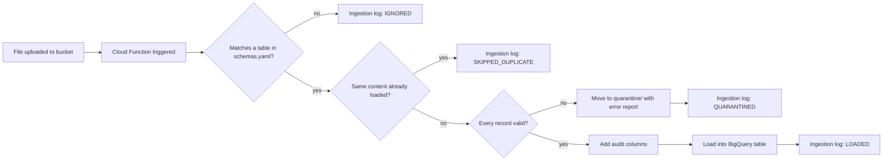
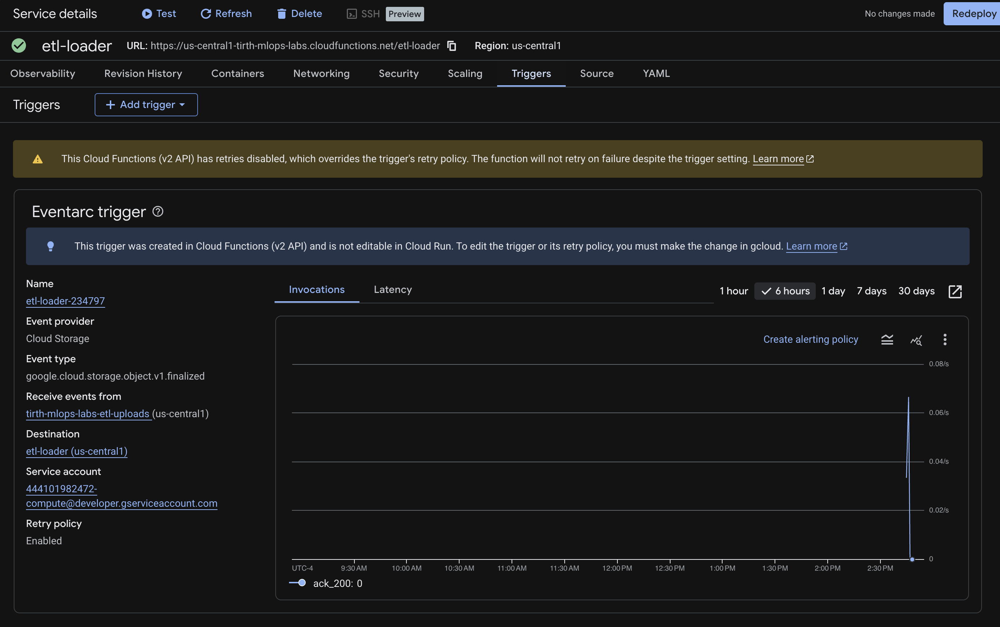
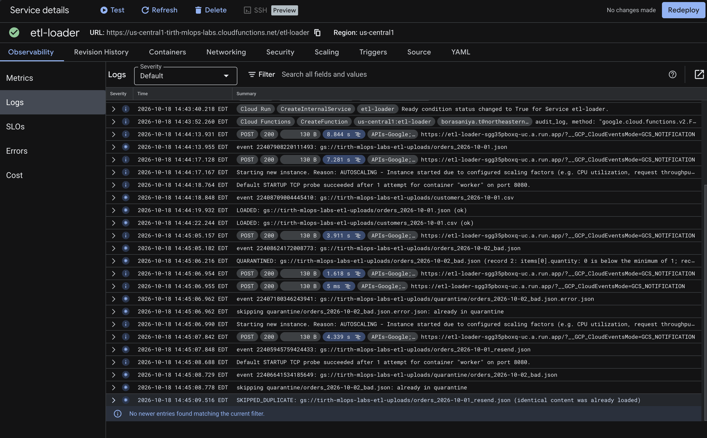
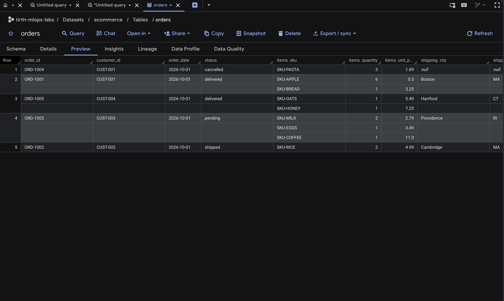
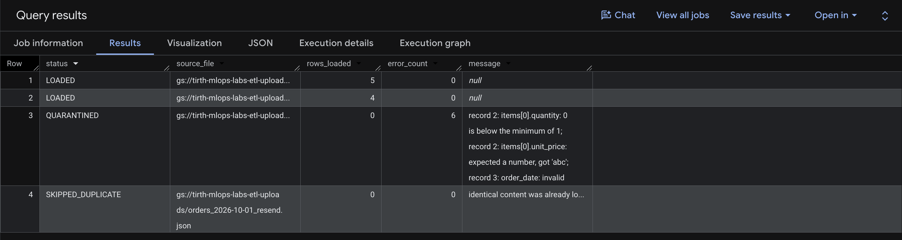
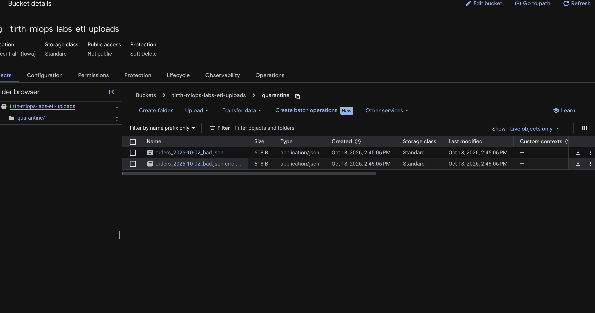
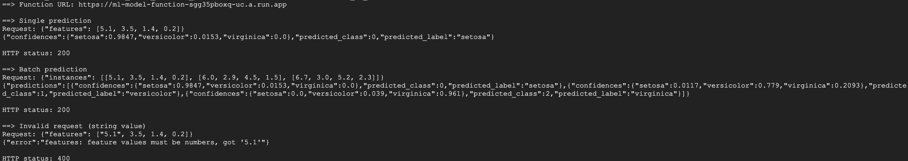

# GCP Lab: Cloud Storage to BigQuery ETL with Cloud Functions

Author: Tirth Borasaniya, IE-7374 MLOps

Based on `Labs/GCP_Labs/CloudFunction_Labs/Lab1-CloudFunction_Setup` from the IE-7374 MLOps course repository. The original lab has two parts: an ETL Cloud Function that loads files uploaded to Cloud Storage into BigQuery, and an ML example, an HTTP Cloud Function that serves Iris predictions. This version keeps both. The ETL pipeline uses a different dataset and adds validation, transformation, logging, and duplicate protection. The ML example is fixed so it deploys on Python 3.11, and is hardened.

**Contents:** [How it works](#how-it-works) · [Summary of changes](#summary-of-changes) · [Changes to the core concept](#changes-to-the-core-concept) · [Prerequisites](#prerequisites) · [Running the lab on GCP](#running-the-lab-on-gcp) · [What a successful run looks like](#what-a-successful-run-looks-like) · [Troubleshooting](#troubleshooting) · [Results](#results) · [Running the tests locally](#running-the-tests-locally)

## How it works



## Summary of changes

| Area | Original lab | This repository |
| --- | --- | --- |
| Dataset | Generic people records (`table_1` to `table_6`) | E-commerce orders (JSON, nested line items) and customers (CSV) |
| File formats | Newline-delimited JSON only; five other configured formats ignored | JSON and CSV, both working |
| Validation | None; invalid files fail inside BigQuery or are silently skipped | Every record checked against the schema; bad files moved to a quarantine folder with an error report |
| Transformation | None (extract and load only) | Typed conversion of CSV values, plus `ingested_at` and `source_file` audit columns |
| Monitoring | Print statements only | `ingestion_log` table in BigQuery recording the outcome of every file |
| Duplicates | Re-uploading a file loads it again | Identical content is detected and skipped |
| Setup | Manual steps in the Cloud Console | `deploy.sh`, `run_demo.sh`, and `teardown.sh` scripts |
| ML example | Cannot deploy on Python 3.11; accepts invalid input; leaks internal errors | Deploys on Python 3.11, strict validation, batch predictions, readable labels |
| Tests | None | 107 tests that run without GCP, plus a GitHub Actions workflow |
| Permissions | BigQuery Admin | Least-privilege roles (BigQuery Data Editor and Job User) |

## Changes to the core concept

The lab's core concept is event-driven serverless code on Cloud Functions. The changes are in the function code and in how it is triggered and deployed, not only in the data:

- **Function logic** (`main.py`, `etl/`): what happens on each upload event was rewritten, adding validation, quarantine, audit columns, an ingestion log, and duplicate protection, with proper error reporting so a failed load marks the run as failed.
- **Triggering and deployment** (`scripts/deploy.sh`): the function is deployed from the command line with its Cloud Storage trigger, environment variable, memory, timeout, and scaling limit set explicitly, instead of through console clicks.
- **Permissions**: least-privilege roles for the function's service account, plus the Pub/Sub publisher role that Cloud Storage triggers need.
- **Second function** (`ML-Example/`): the HTTP-triggered function is fixed so it deploys, and its request handling is rewritten.

The new dataset supports these changes; it is not the main change.

## Modifications to the ETL function

### 1. Different dataset (`schemas.yaml`, `sample_data/`)
The original sample tables hold generic person records. This version models a small online store:

- **`orders`** (newline-delimited JSON): each order has nested, repeated `items` (SKU, quantity, unit price) and an optional nested `shipping` address, so the nested-record capability of the original is kept.
- **`customers`** (CSV): one row per customer, with a date and a boolean column.

`schemas.yaml` was restructured so each table declares an explicit `file_pattern` (such as `orders_*.json`), and fields can declare validation rules (`allowed_values`, `minimum`) that are checked before loading but never sent to BigQuery.

### 2. CSV support (`etl/validation.py`)
CSV files are parsed with a header row, empty cells become `NULL`, and every value is converted to the column's type. For example, `true` becomes a boolean and `2026-10-01` a date. CSV tables are checked at startup to make sure they contain no nested or repeated fields, which CSV cannot represent.

### 3. Validation and quarantine (`etl/validation.py`, `etl/pipeline.py`)
Before anything is loaded, every record is checked for:
- Missing required fields and unknown fields
- Wrong types, such as text in a number column, or impossible dates like `2026-13-45`
- Values outside `allowed_values` (order status) or below `minimum` (quantity of at least 1)
- Nested problems, reported with their location, such as `items[0].quantity`

If any record fails, the whole file is rejected so a table never holds part of a file. The file is moved to `quarantine/` in the bucket, and a JSON report listing every error is written beside it. Files over 50 MB are quarantined without being downloaded. Example report for `sample_data/orders_2026-10-02_bad.json`:

```json
{
  "source_file": "gs://PROJECT-etl-uploads/orders_2026-10-02_bad.json",
  "error_count": 6,
  "errors": [
    "record 2: items[0].quantity: 0 is below the minimum of 1",
    "record 2: items[0].unit_price: expected a number, got 'abc'",
    "record 3: order_date: invalid date '2026-13-45', expected YYYY-MM-DD",
    "record 3: status: 'lost' is not one of ['pending', 'shipped', 'delivered', 'cancelled']",
    "record 4: coupon: unknown field",
    "record 4: customer_id: required field is missing"
  ]
}
```

### 4. Audit columns and ingestion log (`etl/transform.py`)
Every loaded row gets two extra columns: `ingested_at` (processing time) and `source_file` (the `gs://` path it came from), so any row can be traced back to its file.

Every file, whatever happens to it, gets one row in the `ingestion_log` table with its status (`LOADED`, `QUARANTINED`, `SKIPPED_DUPLICATE`, `IGNORED`, or `FAILED`), rows loaded, error count, a short message, and the event ID that links it to the function logs.

### 5. Duplicate protection (`etl/pipeline.py`)
The function computes an MD5 hash of each file's content and checks the ingestion log before loading. If identical content was already loaded into the same table, even under a different file name, the file is skipped and logged as `SKIPPED_DUPLICATE`. A quarantined file that is fixed and re-uploaded has different content, so it loads normally.

## ML example: HTTP prediction function (`ML-Example/`)

The second part of the original lab, kept and fixed. It is a separate HTTP Cloud Function that predicts the Iris species from four flower measurements.

| Problem in the original | Fix |
| --- | --- |
| Pins `numpy 1.21`, `scikit-learn 0.24.2`, and `Flask 2.0.3`, which do not install on Python 3.11, the runtime the lab specifies, so the function cannot deploy | Dependencies updated to versions that support Python 3.11; Flask comes with `functions-framework` |
| Input check accepts `NaN`, infinity, booleans, and numeric strings such as `"5.1"` | Only finite numbers are accepted |
| Every error returns Python's internal error message to the caller | Clear 400 messages for bad input; unexpected errors are logged by the platform instead of exposed |
| Accepts any HTTP method | Only POST is allowed (405 otherwise) |
| Saves the model to `/tmp` and reloads it from disk on every request | Trained once when the instance starts and kept in memory |
| Returns only a class number and an unlabeled nested list of probabilities | Returns the species name and confidences keyed by species |
| One flower per request | Optional batch of up to 100 flowers with `"instances"` |
| Entry point named `logfunction` | Renamed to `predict` |

Request and response:

```bash
curl -X POST "$URL" -H "Content-Type: application/json" \
  -d '{"features": [5.1, 3.5, 1.4, 0.2]}'
```

```json
{
  "predicted_class": 0,
  "predicted_label": "setosa",
  "confidences": {"setosa": 0.9847, "versicolor": 0.0153, "virginica": 0.0}
}
```

A batch request sends `{"instances": [[...], [...]]}` and returns `{"predictions": [...]}`.

## Bugs fixed in the ETL function

| Problem in the original | Fix |
| --- | --- |
| `job_config.source_format = ...NEWLINE_DELIMITED_JSON,` and the `write_disposition` line end in a stray comma, which turns each value into a tuple | Load settings passed directly to a new `LoadJobConfig` |
| One module-level `job_config` is shared and mutated by every invocation | A fresh configuration is built for every load |
| Files are matched with an unescaped regex search on the name, so `table_10.json` also matches `table_1` | Explicit wildcard patterns per table; a file matching two tables is an error |
| Five of the six configured formats are never handled; those files are silently ignored | Every configured format is supported, and the config is validated at startup |
| Every error is caught and printed, so failed loads still report success | Expected problems are quarantined and logged; real load failures are logged and re-raised so the run shows as failed |
| `PROJECT_ID = os.getenv('cloudquicklab')` reads a variable that does not exist and is never used | Removed; the dataset name comes from the `BQ_DATASET` environment variable |
| Nested fields are built by setting the private `_fields` attribute | Schemas built with BigQuery's public API |
| `zip` is stored as `INT64`, so leading zeros are lost (`02115` becomes `2115`) | ZIP codes stored as text |
| Table existence is checked by catching every exception | Tables created with `exists_ok=True` |
| Google clients are created when the module is imported, so the code cannot be tested without credentials | Cloud access isolated in `etl/gcp.py`; the pipeline takes adapters as arguments and is tested with in-memory fakes |

## Project structure

```
.
├── .github/workflows/tests.yml   # runs lint and tests on every push
├── docs/screenshots/              # evidence that the pipeline ran on GCP
├── ML-Example/
│   ├── main.py                    # HTTP prediction function: predict
│   └── requirements.txt
├── etl/
│   ├── config.py                  # loads and validates schemas.yaml, matches files to tables
│   ├── errors.py                  # exception types
│   ├── gcp.py                     # Cloud Storage and BigQuery adapters
│   ├── pipeline.py                # processes one file from match to log
│   ├── transform.py               # audit columns, ingestion log schema
│   └── validation.py              # parses JSON and CSV, converts and checks values
├── sample_data/
│   ├── customers_2026-10-01.csv
│   ├── orders_2026-10-01.json
│   └── orders_2026-10-02_bad.json # contains six deliberate errors
├── scripts/
│   ├── config.sh                  # shared settings
│   ├── deploy.sh                  # creates resources and deploys the ETL function
│   ├── deploy_ml.sh               # deploys the ML example
│   ├── run_demo.sh                # uploads sample files and shows results
│   ├── run_ml_demo.sh             # sends test requests to the ML example
│   └── teardown.sh                # deletes everything
├── tests/
├── main.py                        # Cloud Function entry point: process_upload
├── schemas.yaml
├── requirements.txt               # deployed with the function
└── requirements-dev.txt           # adds pytest and flake8 for local testing
```

## Prerequisites

Nothing needs to be installed on your computer to run the lab. Everything runs in **Google Cloud Shell**, a browser-based terminal that already includes the Google Cloud CLI (`gcloud`, `bq`), Git, and Python.

You need:

1. **A Google account.**
2. **A Google Cloud project with billing enabled.** Free-trial credits work. To create one, open https://console.cloud.google.com, click the project picker at the top, choose **New Project**, and link a billing account when prompted. Note the **project ID** (for example `my-project-123456`), which is not always the same as the project name.

Running the unit tests on your own computer is optional and needs Python 3.11 and Git; see [Running the tests locally](#running-the-tests-locally).

### Software versions

| Software | Version | Where it is needed |
| --- | --- | --- |
| Cloud Functions runtime | Python 3.11 (set by the deploy scripts) | Runs on Google Cloud; nothing to install |
| Google Cloud CLI (`gcloud`, `bq`) | Any release from 2024 onward | Preinstalled in Cloud Shell |
| Python | 3.11 | Only for running the tests locally |
| Python packages | Pinned ranges in `requirements.txt`, `requirements-dev.txt`, and `ML-Example/requirements.txt` | Installed automatically by the deploy and by `pip` |

### Optional: running from your own computer instead of Cloud Shell

1. Install the Google Cloud CLI by following https://cloud.google.com/sdk/docs/install for your operating system. It includes `gcloud` and `bq`.
2. Sign in and choose your project:
   ```bash
   gcloud auth login
   gcloud config set project YOUR_PROJECT_ID
   ```
3. Install Git (https://git-scm.com/downloads). On Windows, run the scripts from **Git Bash**, which comes with Git, since they are Bash scripts.
4. Continue from step 2 below, skipping the `gcloud config set project` line you already ran.

## Running the lab on GCP

**1. Open Cloud Shell.** In the Google Cloud Console, make sure your project is selected in the project picker, then click the **Activate Cloud Shell** icon (a terminal symbol) at the top right. A terminal opens at the bottom of the page.

**2. Download the code and select your project:**

```bash
git clone https://github.com/TirthBorasaniya/gcp_cloud_function_lab.git
cd gcp_cloud_function_lab
gcloud config set project YOUR_PROJECT_ID
```

Replace `YOUR_PROJECT_ID` with your project ID. If Cloud Shell asks to authorize, click **Authorize**.

**3. Create the resources and deploy the ETL function** (about 5 minutes on the first run):

```bash
./scripts/deploy.sh
```

This enables the required APIs, creates a bucket named `YOUR_PROJECT_ID-etl-uploads` and a BigQuery dataset named `ecommerce`, grants the service account its roles, and deploys the function `etl-loader`. The script can be run again safely.

**4. Upload the sample files and check the results** (about 2 minutes):

```bash
./scripts/run_demo.sh
```

**5. Deploy and test the ML example** (about 4 minutes):

```bash
./scripts/deploy_ml.sh
./scripts/run_ml_demo.sh
```

**6. Delete everything when finished:**

```bash
./scripts/teardown.sh
```

Type `y` to confirm. This removes both functions, the bucket, the dataset, and the stored container images.

To use different names or a different region, set any of `REGION`, `BUCKET`, `DATASET`, `FUNCTION_NAME`, or `ML_FUNCTION_NAME` before running the scripts, for example `REGION=us-east1 ./scripts/deploy.sh`. Defaults are in `scripts/config.sh`.

## What a successful run looks like

**`deploy.sh`** finishes with the function details from `gcloud`, including `state: ACTIVE`, followed by:

```
==> Done. Run ./scripts/run_demo.sh to upload the sample files.
```

**`run_demo.sh`** uploads four files and prints three tables and the quarantine contents. The ingestion log shows one row per file:

| status | source_file | rows_loaded | error_count |
| --- | --- | --- | --- |
| LOADED | gs://...-etl-uploads/orders_2026-10-01.json | 5 | 0 |
| LOADED | gs://...-etl-uploads/customers_2026-10-01.csv | 4 | 0 |
| QUARANTINED | gs://...-etl-uploads/orders_2026-10-02_bad.json | 0 | 6 |
| SKIPPED_DUPLICATE | gs://...-etl-uploads/orders_2026-10-01_resend.json | 0 | 0 |

The `orders` table then shows orders `ORD-1001` to `ORD-1005` with their item counts and ZIP codes, including leading zeros such as `02115`. The `customers` table shows 4 customers, with an empty email for `CUST-002`. The quarantine folder lists `orders_2026-10-02_bad.json` and its `.error.json` report, which contains the six errors shown in modification 3 above.

**`run_ml_demo.sh`** sends three requests:

```
==> Single prediction
{"confidences":{"setosa":0.9847,"versicolor":0.0153,"virginica":0.0},"predicted_class":0,"predicted_label":"setosa"}
HTTP status: 200

==> Batch prediction
{"predictions":[ ... "predicted_label":"setosa" ... "predicted_label":"versicolor" ... "predicted_label":"virginica" ... ]}
HTTP status: 200

==> Invalid request (string value)
{"error":"features: feature values must be numbers, got '5.1'"}
HTTP status: 400
```

Confidence values may differ slightly between library versions; the predicted labels should match.

## Troubleshooting

| Problem | Cause and fix |
| --- | --- |
| `No GCP project selected` | Run `gcloud config set project YOUR_PROJECT_ID`. |
| Permission, "service agent", or "service account does not exist" errors during `deploy.sh` | Newly enabled APIs, service agents, and roles take a few minutes to apply. The script retries for up to three minutes; if it still fails, wait and run `./scripts/deploy.sh` again. |
| `storage.buckets.get` denied, or "Eventarc service account" in a deploy error | Eventarc's service agent is still being set up on a new project. Wait three minutes and run `./scripts/deploy.sh` again. |
| `Permission denied` when running a script | Run `chmod +x scripts/*.sh` once, then try again. |
| `Billing account ... not found` or APIs fail to enable | Billing is not linked to the project. Link it under **Billing** in the Console. |
| `run_demo.sh` tables are empty or missing | The first run includes a cold start. Wait a minute and run `./scripts/run_demo.sh` again; files already loaded are reported as duplicates rather than loaded twice. |
| `deploy_ml.sh` fails on `--allow-unauthenticated` | Accounts managed by an organization can block public functions. Use a personal Google account and project. |
| Function errors | Open **Cloud Run functions** in the Console, select the function, and check the **Logs** tab. |

## Results

Screenshots from the deployed pipeline:

1. Deployed function with its Cloud Storage trigger: `docs/screenshots/01_function.png`
2. Function logs showing the LOADED, QUARANTINED, and SKIPPED_DUPLICATE runs: `docs/screenshots/02_logs.png`
3. `orders` table in BigQuery with nested items and audit columns: `docs/screenshots/03_orders_table.png`
4. `ingestion_log` query results: `docs/screenshots/04_ingestion_log.png`
5. Quarantine folder in the bucket with the error report: `docs/screenshots/05_quarantine.png`
6. ML example responding to requests: `docs/screenshots/06_ml_prediction.png`








## Running the tests locally

The ETL tests use in-memory stand-ins for Cloud Storage and BigQuery, and the ML tests call the function through Flask test requests, so no GCP account is needed. The same checks run automatically on every push in GitHub Actions.

Requirements: **Python 3.11** (download from https://www.python.org/downloads/, and on Windows tick "Add Python to PATH" during installation) and **Git** (https://git-scm.com/downloads). Check both:

```bash
python3 --version     # Windows: python --version
git --version
```

Then:

```bash
git clone https://github.com/TirthBorasaniya/gcp_cloud_function_lab.git
cd gcp_cloud_function_lab
python3 -m venv cf_lab_env
source cf_lab_env/bin/activate      # Windows: cf_lab_env\Scripts\activate
pip install -r requirements-dev.txt
pytest
flake8 main.py etl tests ML-Example --max-line-length 100
```

A successful run ends with `107 passed`, and flake8 prints nothing.

## Cost and cleanup

At this scale the function, bucket, and BigQuery usage stay within Google Cloud's free tier, and data is loaded with batch load jobs, which are free, rather than streaming inserts. `--max-instances=3` caps how far the function can scale. When finished:

```bash
./scripts/teardown.sh
```

This deletes both functions, the bucket and its files, the dataset, and the stored container images.
